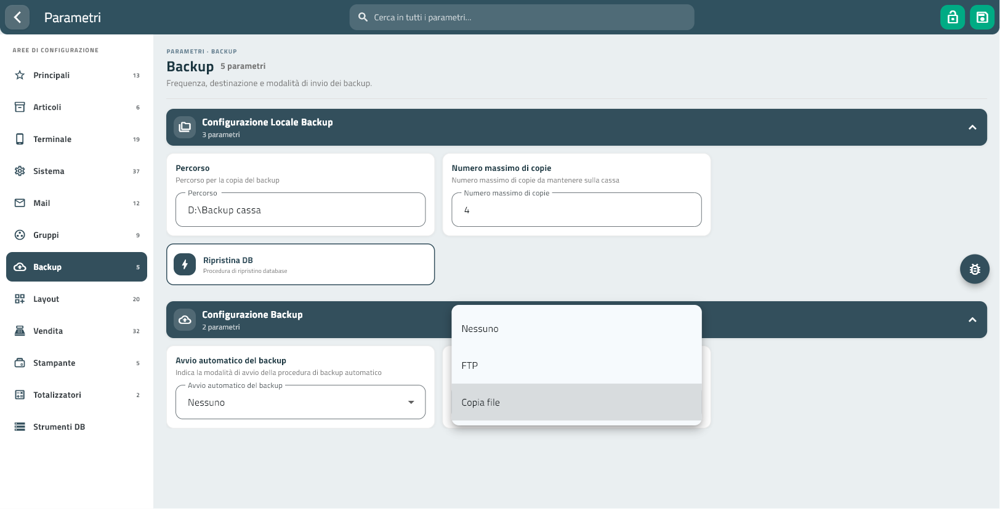
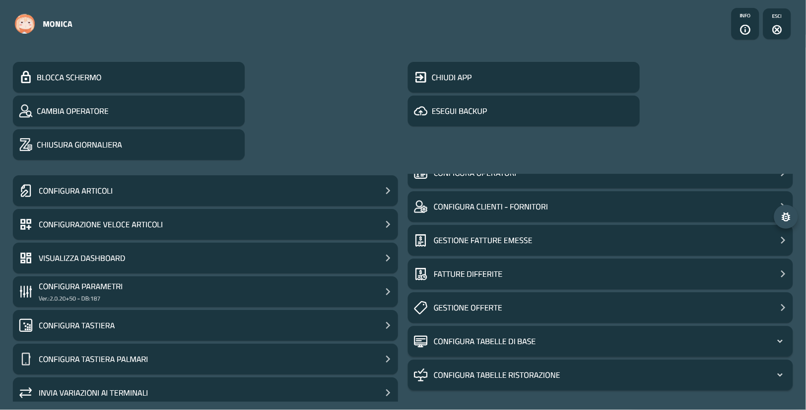
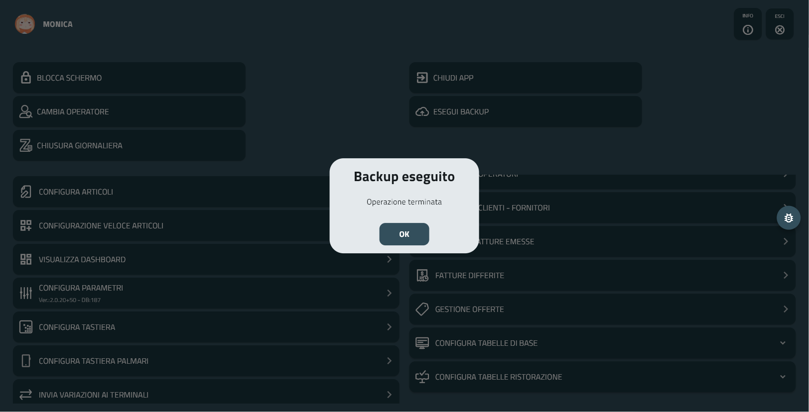
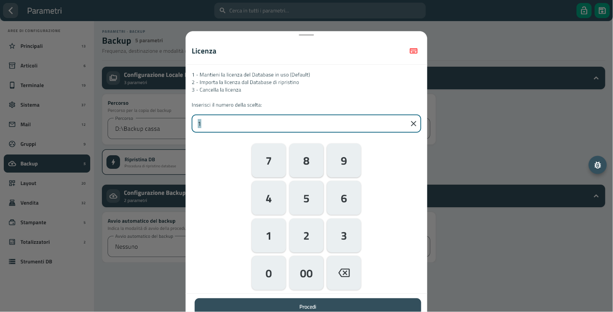

# Backup e ripristino della cassa

Configurazione dell'invio, backup manuale, avvisi e ripristino con la scelta della licenza.

[Scarica la guida in PDF](assets/resources/guida-backup-ripristino.pdf)

## Come si usa

### Configurare il backup

Parametri → area **Backup**:

- **Invio del backup**: Nessuno, FTP o Copia file.
- Con **Copia file**: il **Percorso** (per esempio un disco esterno o una cartella di rete) e il **Numero massimo di copie** da tenere.
- Con **FTP**: dati del server e modalità **Passiva** o **Attiva**. L'attiva serve con i server che non accettano la passiva.
- **Avvio automatico del backup**: quando farlo da solo.

*Area Backup dei Parametri e modalità di invio*

### Fare un backup

1. Menu dell'operatore → **Esegui backup** → OK.

    

    *Esegui backup nel menu dell'operatore*

2. A fine copia compare «Backup eseguito».

    

    *Backup riuscito*

- Se l'invio è su **Nessuno**, la cassa ora dice cosa configurare. Nella 1.0.33 compariva solo «Funzione disabilitata».

    

    *Avviso con l'invio del backup su Nessuno*

- Con l'avvio automatico attivo non si può mettere l'invio su Nessuno: prima va spento l'avvio automatico.
- Con FTP, se il backup non arriva sul server la cassa lo dice. Nella 1.0.33 poteva risultare riuscito anche quando non era stato fatto.

### Ripristinare un backup

1. Parametri → **Backup** → **Ripristina DB**. La cassa avvisa che a fine ripristino il programma si chiude.
2. Scegliere cosa fare della licenza: **1** mantiene quella del database in uso (predefinito), **2** importa quella del backup, **3** la cancella.

    

    *Scelta della licenza prima del ripristino*

3. Scegliere il backup: dalla cartella con Copia file, dall'elenco del server con FTP.

- Si accettano solo backup di Inventa One: un altro file viene rifiutato e il database resta com'era.
- Il ripristino usa la modalità di invio impostata: con Nessuno chiede di sceglierne una prima.
- Corretto il ripristino interrotto che faceva perdere il database.

## Licenza

- L'avviso «licenza offline» non si ripresenta ogni 3 minuti.
- Una licenza rifiutata blocca davvero la vendita (prima riavviando si tornava a vendere).
- «Carica licenza» funziona dalla finestra di blocco.

!!! warning "Attenzione"
    Il backup su Google Drive resta nascosto come nella 1.0.33, perché non è ancora pronto. Se un cliente lo vede, è un errore da segnalare.

??? info "Riferimenti"
    Vale per Inventa One 2.0.21 (schermate della 2.0.20). Guida verificata il 16/11/2026.

    Card di riferimento: [IFEV-3846](https://customgroup.atlassian.net/browse/IFEV-3846), [IFEV-3853](https://customgroup.atlassian.net/browse/IFEV-3853), [IFEV-4236](https://customgroup.atlassian.net/browse/IFEV-4236).
