# Configura tastiera: selezione multipla, copia e nuovi tasti

La novità principale è la selezione multipla dei tasti con le azioni di gruppo: prima ogni operazione si ripeteva tasto per tasto, ora si selezionano più tasti e si agisce su tutti insieme. Clona pagina, scambio col trascinamento e colori personalizzati esistevano già: ora sono più affidabili e si applicano a più tasti alla volta. Queste funzioni ci sono solo nella linea 2.0: nella 1.0.x non ci sono.

[Scarica la guida «Configura tastiera: copiare e incollare più in fretta» in PDF](assets/resources/guida-configura-tastiera.pdf) · [Scarica «Tastiera Inventa One – modifiche (ottobre 2026)» in PDF](assets/resources/tastiera-modifiche-ottobre-2026.pdf)

| Funzione | Cosa cambia per chi configura |
| --- | --- |
| Selezione multipla e azioni di gruppo | «Seleziona» e «Azioni (N)»: copia su altre pagine, applica stile, svuota, tasto dinamico, copia/incolla in blocco |
| Copia e incolla su più tasti | «Copia» con tutto già spuntato; incollando il tipo su N tasti si scelgono N reparti/funzioni/pagamenti da una lista |
| Clona pagina | Pulsante «Clona» grande, pagina nuova subito visibile, nome proposto, avvisi |
| Scambio col trascinamento | Si sposta tutto il contenuto del tasto; bloccato se un tasto coprirebbe i vicini |
| Colori e stili | Stile applicato a più tasti; colori che seguono copia, scambio e annullo |
| Annulla modifica tastiera | Toglie anche pagine e tasti nati in modifica; ritentabile se il backoffice rifiuta |
| Tasto «Gruppo reparti» | Nuova anagrafica Gruppi reparto e funzione di tasto che apre i reparti del gruppo |
| Tasto «Funzioni» | Un solo tasto che raccoglie più funzioni |

## Entrare e uscire dalla modifica

1. Aprire la vendita senza sala né tavolo selezionati, altrimenti compare «È necessario deselezionare sala o tavolo per modificare la tastiera».
2. Menu dell'operatore → **Configura tastiera**: la barra di stato mostra «In modifica» e in alto compaiono **PAGINE** e **SELEZIONA**.
3. Per finire, di nuovo il menu dell'operatore → **Conferma modifica tastiera** per tenere tutto, oppure **Annulla modifica tastiera** per tornare a com'era.

In modifica:

- un tocco su un tasto apre la sua configurazione;
- la pressione lunga apre il menu del tasto: tasto dinamico, «Copia configurazione tasto», «Incolla configurazione tasto», «Copia sulle pagine selezionate»;
- trascinando un tasto sopra un altro i due si scambiano;
- tutti i tasti sono grigi: i colori nuovi si vedono in vendita dopo la conferma;
- sugli schermi stretti Home e Pref spariscono dalla barra: per cambiare pagina si usa PAGINE.

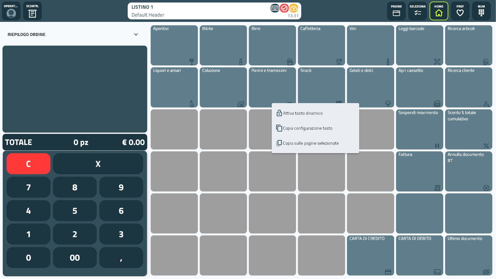

*Il menu che si apre con la pressione lunga su un tasto*

## Cambiare pagina e clonarla

1. **PAGINE** apre «Seleziona pagina», con la pagina corrente evidenziata: si passa da una pagina all'altra senza uscire dalla modifica.

    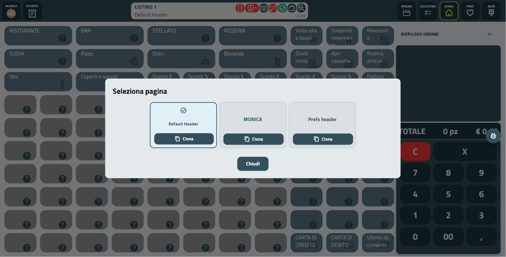

    *Seleziona pagina, con Clona su ogni pagina*

2. Sotto la pagina da copiare toccare **Clona** e confermare il nome proposto («&lt;pagina&gt;_replica», poi «_replica 2»…) o scriverne un altro. Un nome già usato viene rifiutato.

    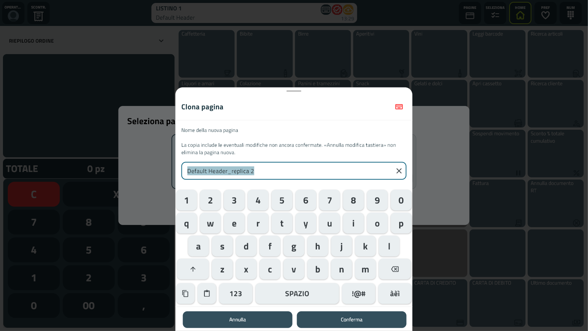

    *Il nome della pagina nuova*

3. La pagina nuova compare subito dopo quella di partenza, evidenziata in verde.

    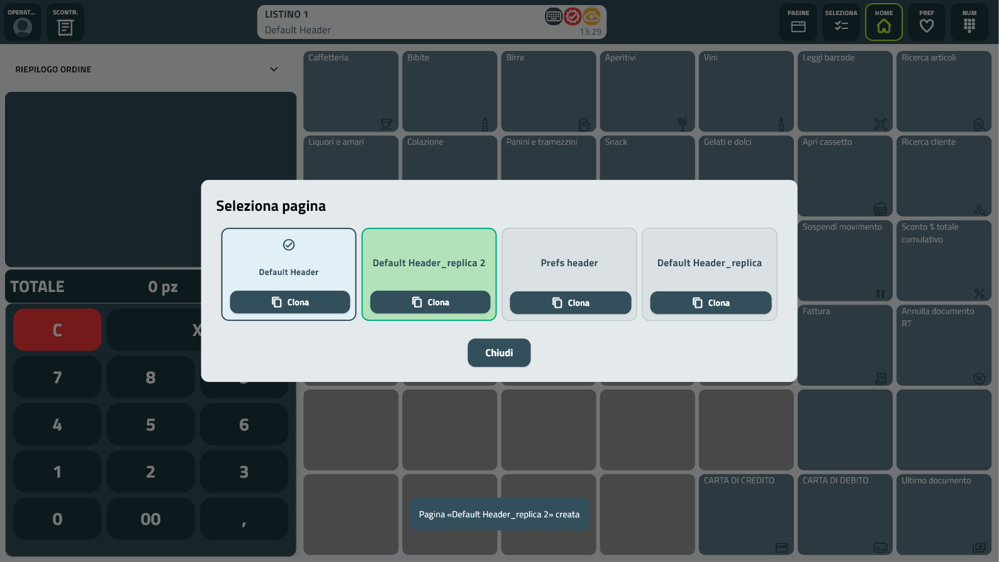

    *La pagina clonata nella finestra Seleziona pagina*

Da sapere:

- La copia comprende anche le modifiche non ancora confermate. «Annulla modifica tastiera» non cancella la pagina nuova.
- Se le pagine del terminale sono assegnate dal backoffice, la pagina nuova va assegnata da lì, altrimenti alla riapertura non compare.

Cosa è cambiato rispetto a prima:

- Il pulsante Clona era un tondino difficile da toccare sul palmare: ora è una barra a tutta larghezza con icona e scritta.
- La pagina clonata si vede subito, senza chiudere e riaprire la finestra.
- Un doppio tocco non crea più due copie, e la finestra resta bloccata finché la copia non finisce.
- Un nome già usato viene rifiutato e la finestra del nome si ripropone.
- Una pagina senza tasti si clona come pagina vuota.

## Selezionare più tasti

1. Toccare **SELEZIONA**: l'icona diventa verde e compare **AZIONI (N)**.
2. Toccare i tasti uno per uno, oppure trascinare un rettangolo sulla griglia: i tasti scelti prendono il bordo verde.
3. Toccare **AZIONI (N)**, oppure tenere premuto un tasto: si apre il menu delle azioni (Seleziona tutti, Deseleziona, Copia e Incolla configurazione tasto, Attiva e Disattiva tasto dinamico, Copia su altre pagine, Applica stile, Svuota tasti).
4. Per finire, toccare di nuovo SELEZIONA: la selezione si azzera.

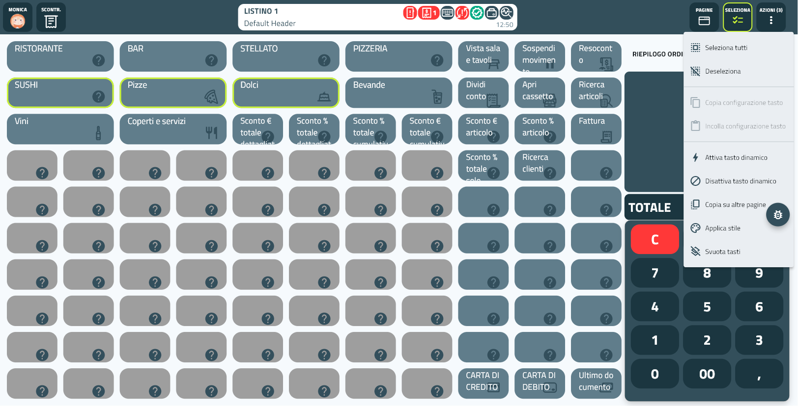

*Tre tasti selezionati e il menu AZIONI*

| Voce del menu | Cosa fa |
| --- | --- |
| Seleziona tutti / Deseleziona | Seleziona o libera tutti i tasti della pagina |
| Copia configurazione tasto | Attiva con un solo tasto selezionato: copia gli aspetti scelti |
| Incolla configurazione tasto | Incolla gli aspetti copiati su tutti i tasti selezionati |
| Attiva / Disattiva tasto dinamico | Rende dinamici (o no) tutti i tasti selezionati |
| Copia su altre pagine | Copia i tasti selezionati nelle stesse posizioni delle pagine scelte |
| Applica stile | Assegna uno stile a tutti i tasti selezionati, togliendo i colori personalizzati |
| Svuota tasti | Cancella il contenuto dei tasti selezionati, con conferma |

Da sapere:

- Scontrino e tastierino non si selezionano.
- Con SELEZIONA acceso lo scambio per trascinamento è sospeso e la barra nasconde Home, Pref e Num; cambiare pagina azzera la selezione.
- Durante un'azione la cassa resta in attesa; alla fine un solo messaggio riporta i tasti aggiornati e quelli saltati.

## Copiare tasti su altre pagine

Selezionare i tasti → **Copia su altre pagine** → spuntare le pagine → Conferma. I tasti finiscono nelle stesse posizioni delle pagine scelte.

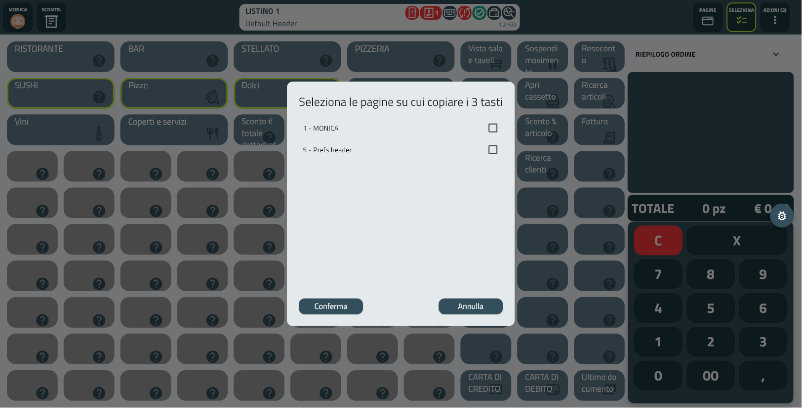

*Scelta delle pagine su cui copiare*

- Per rendere una pagina uguale a un'altra: dalla pagina di partenza **Seleziona tutti** e poi Copia su altre pagine.
- Un tasto che sulla pagina di destinazione coprirebbe lo scontrino, il tastierino o un tasto grande viene saltato; il messaggio finale lo dice.
- Vengono proposte solo le pagine della cassa, esclusa quella corrente. La funzione non c'è in «Configura tastiera palmari».

## Incollare un tasto su più tasti

1. Tenere premuto il tasto da copiare (oppure selezionarlo e aprire AZIONI) → **Copia configurazione tasto**. Tipo, dimensione, grafica e icona sono già spuntati → OK.

    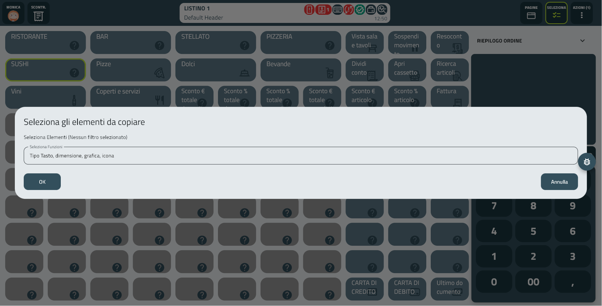

    *Cosa copiare dal tasto*

2. SELEZIONA → toccare i tasti di destinazione → AZIONI → **Incolla configurazione tasto** → OK.

    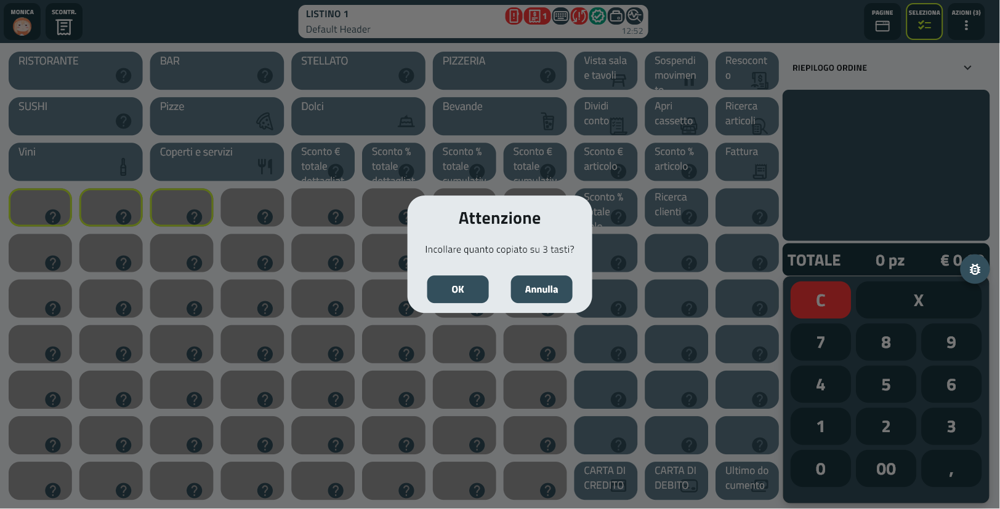

    *Conferma dell'incolla su più tasti*

3. Se il tasto copiato è un reparto, una funzione, un pagamento o una pagina, si apre la lista a scelta multipla: si sceglie un elemento per ogni tasto, con il contatore «x di N». Conferma si attiva solo a selezione completa.

    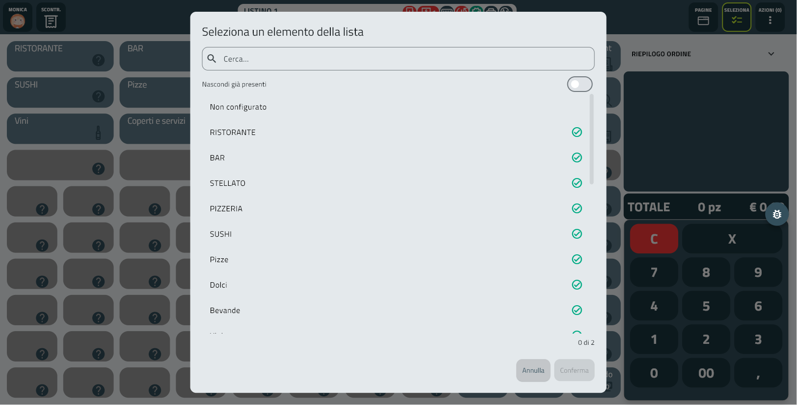

    *Lista con il segno «già presente» e il contatore*

4. Il primo elemento spuntato va sul primo tasto e così via; i tasti si salvano senza aprire la loro configurazione e compare «Tasti configurati: N, saltati: 0».

    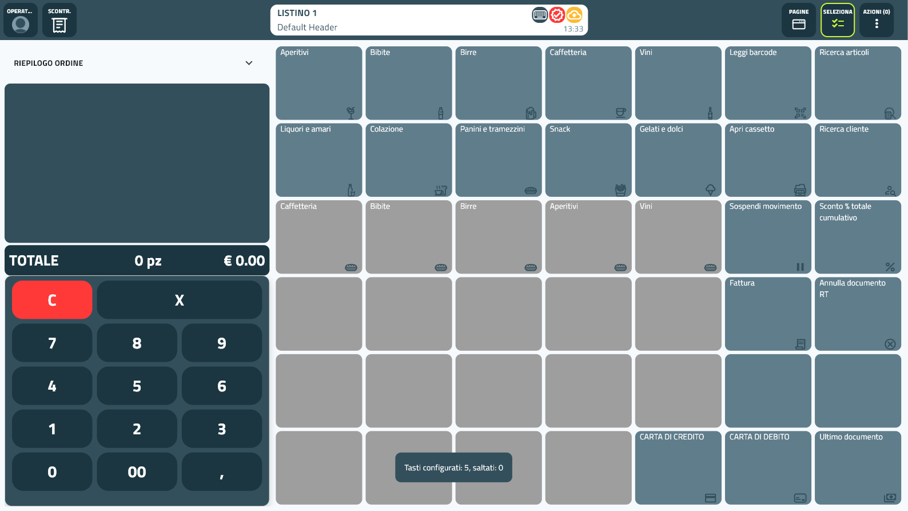

    *Cinque tasti configurati in un colpo*

Da sapere:

- Il segno verde indica gli elementi già presenti in tastiera; **Nascondi già presenti** li toglie dalla lista. Lo stesso segno compare quando si modifica un tasto a mano.
- Si copiano anche icona e grafica: se non servono, togliere «icona» e «grafica» nella finestra di copia.
- Gli articoli si scelgono ancora uno alla volta, ma senza passare dalla configurazione del tasto.
- Se gli elementi disponibili sono meno dei tasti compare un avviso; chiudendo la lista senza conferma i tasti restano com'erano.
- Una dimensione più grande sposta i vicini nella prima cella libera; se uno non trova posto, quel tasto si salta.
- Il tipo scontrino o tastierino non si incolla su più tasti.

## Scambiare due tasti col trascinamento

1. Con SELEZIONA spento, trascinare un tasto sopra un altro e rilasciare.
2. I due tasti si scambiano subito, con il loro colore e l'eventuale report collegato.

- Se un tasto grande coprirebbe i vicini o lo scontrino, o uscirebbe dal bordo, lo scambio si blocca con il messaggio «Tasti non scambiati…».
- Scontrino e tastierino non si scambiano; le celle lasciate libere da un tasto grande diventano tasti vuoti da configurare.

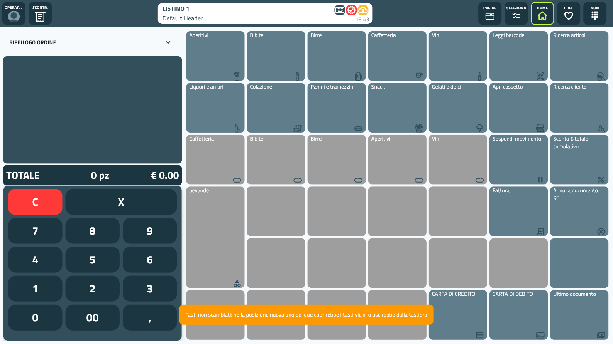

*Scambio bloccato: un tasto grande coprirebbe i vicini*

## Colori e stili

- **Un tasto**: toccare il tasto → «Seleziona una grafica per il pulsante» per lo stile, oppure riquadro **Colori Personalizzati** → Abilita per un colore libero.

    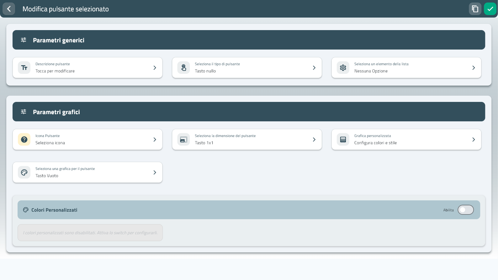

    *Stile e colori personalizzati nella configurazione del tasto*

- **Più tasti**: SELEZIONA → toccare i tasti → AZIONI → **Applica stile** → scegliere lo stile (Funzioni, Articoli, Reparti, Pagamenti…) → confermare. I colori personalizzati di quei tasti vengono tolti.

    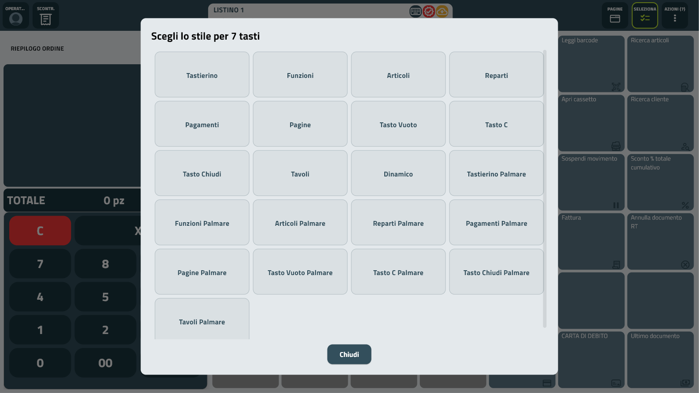

    *Scelta dello stile per sette tasti*

- Dopo «Conferma modifica tastiera» i colori si vedono in vendita.

    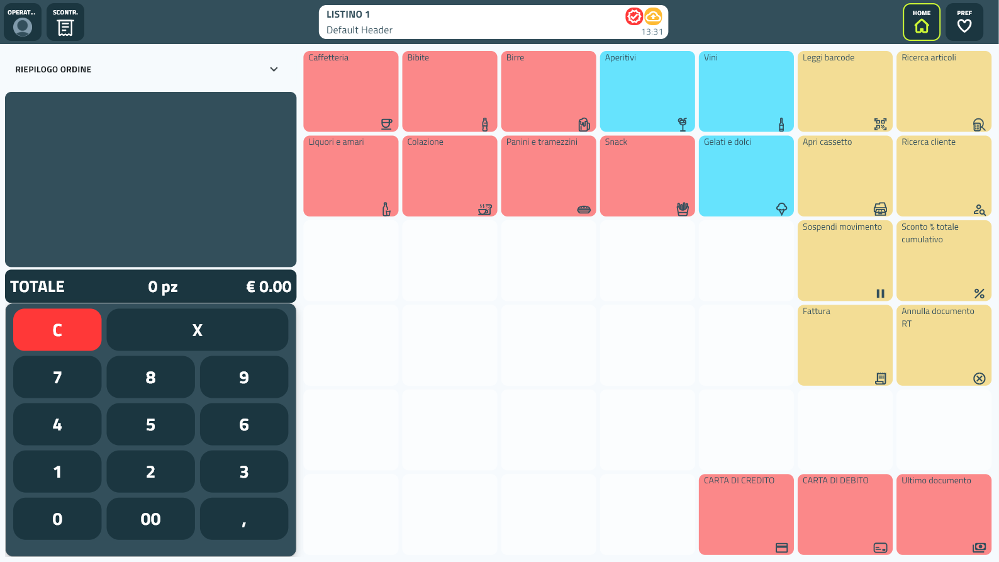

    *I tasti con lo stile nuovo in vendita*

- I colori seguono anche copia e incolla della grafica, Copia su altre pagine, lo scambio e l'annullo. In vendita una cella vuota non prende più i colori di un altro tasto.

## Annullare tutto

**Annulla modifica tastiera** riporta la tastiera esattamente com'era quando si è entrati in modifica: tasti modificati, pagine visitate, tastierino dinamico, colori personalizzati (anche sui terminali client), pagine di destinazione di una copia, pagine e tasti creati in modifica (anche sul backoffice) e celle vuote diventate tasti.

- Se il backoffice rifiuta o non risponde, si resta in modifica, compare il motivo e l'annullo si può ritentare.
- Due eccezioni, segnalate a video: la pagina creata con Clona resta, e la modifica del riquadro di vendita dei palmari non si annulla.

## Nuovo tasto «Funzioni»

Un solo tasto che raccoglie tutte le funzioni: in vendita apre l'elenco delle funzioni disponibili, utile sulle tastiere con poco spazio.

## Nuovo tasto «Gruppo reparti»

Un solo tasto raggruppa più reparti: in vendita fa scegliere il reparto del gruppo e poi si comporta come il tasto Reparto. Serve a tenere in tastiera un tasto «Bevande» invece di cinque tasti reparto.

1. **Anagrafica**: Configura tabelle di base → **Gruppi reparto** (subito sotto Reparti, stesso permesso dei Reparti). Si creano descrizione e ordine; un gruppo con reparti assegnati non si cancella.
2. **Reparti**: nella pagina Reparti c'è la tendina **Gruppo** (Nessuno o un gruppo).
3. **Tasto**: in Configura tastiera si sceglie la funzione «Gruppo reparti» e il gruppo da elenco; l'etichetta del tasto prende il nome del gruppo.
4. **Vendita**: si digita l'importo e si preme il tasto; compare la scelta dei reparti del gruppo (con un solo reparto non chiede niente) e la riga viene battuta sul reparto scelto.

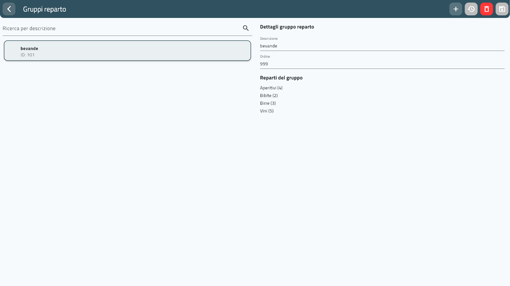

*Anagrafica Gruppi reparto*

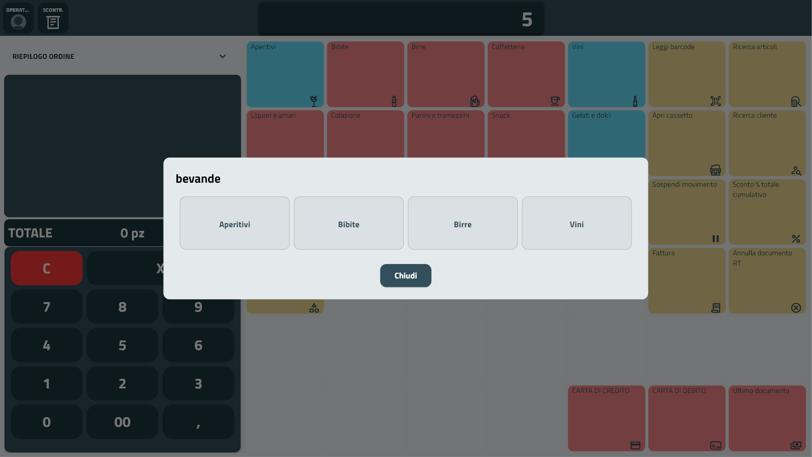

*In vendita: scelta del reparto del gruppo «bevande»*

- Come il tasto Reparto, a display vuoto il tasto non fa nulla, salvo con i tasti dinamici o sul palmare. Un gruppo senza reparti mostra «Nessun reparto nel gruppo».
- I gruppi si sincronizzano col backoffice e il tasto si configura anche dall'editor tastiera web del backoffice.

??? info "Riferimenti"
    Vale per Inventa One 2.0.21 (schermate della 2.0.20 e della prova del 29/10 sulla versione di test). Guida verificata il 16/11/2026.

    FST e card di riferimento: FST-3191, [IFEV-3523](https://customgroup.atlassian.net/browse/IFEV-3523), [IFEV-3881](https://customgroup.atlassian.net/browse/IFEV-3881), [IFEV-3882](https://customgroup.atlassian.net/browse/IFEV-3882), [IFEV-2953](https://customgroup.atlassian.net/browse/IFEV-2953), [IFEV-3619](https://customgroup.atlassian.net/browse/IFEV-3619), [IFEV-3339](https://customgroup.atlassian.net/browse/IFEV-3339), [IFEV-3338](https://customgroup.atlassian.net/browse/IFEV-3338), [IFEV-3337](https://customgroup.atlassian.net/browse/IFEV-3337), [IFEV-3896](https://customgroup.atlassian.net/browse/IFEV-3896), [IFEV-3617](https://customgroup.atlassian.net/browse/IFEV-3617), [IFEV-2880](https://customgroup.atlassian.net/browse/IFEV-2880).

    Epiche: IFEV-3520 (copia più rapida), IFEV-3330 (problemi configurazione tastiera), IFEV-3615 (Gruppo reparti).

    Fonti: «Configura tastiera: copiare e incollare più in fretta», «Tastiera Inventa One – modifiche (ottobre 2026)», Guida al changelog per i tecnici installatori (cap. 9).
