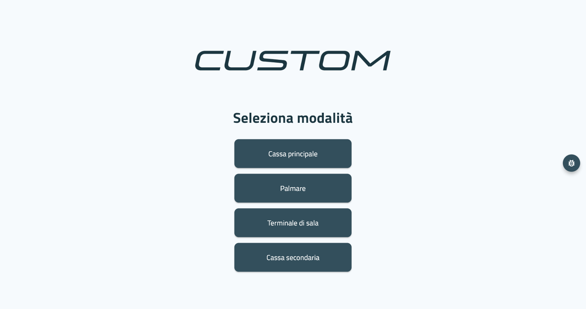
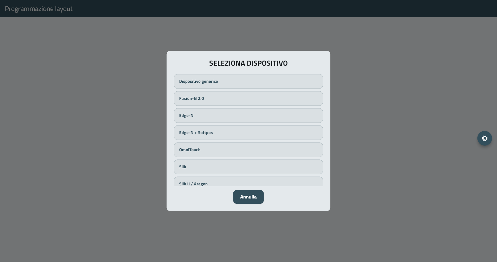
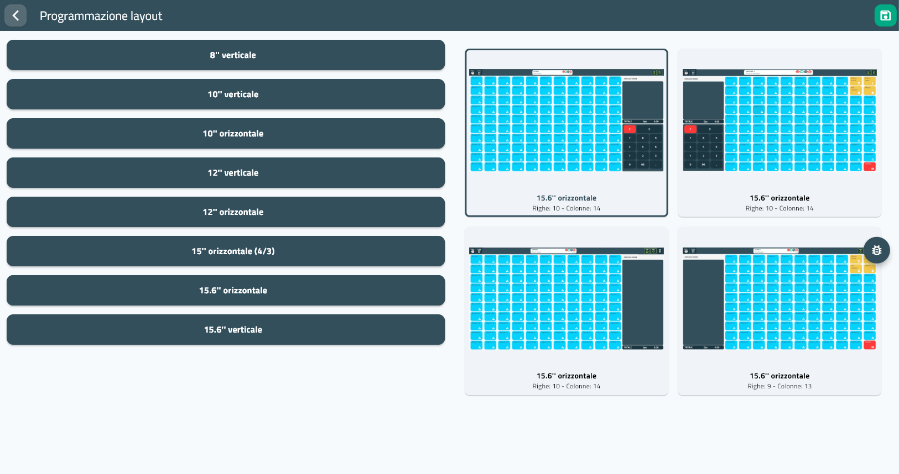
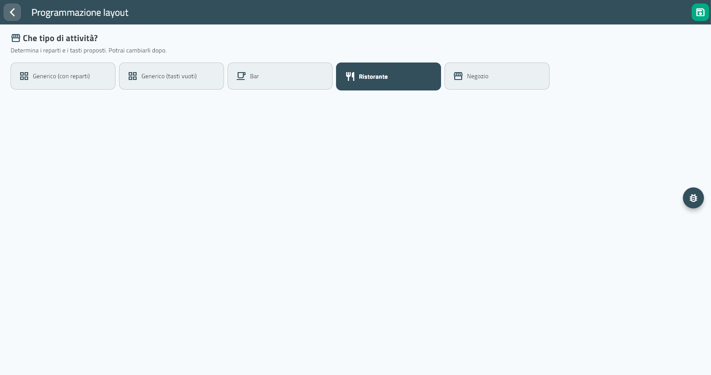
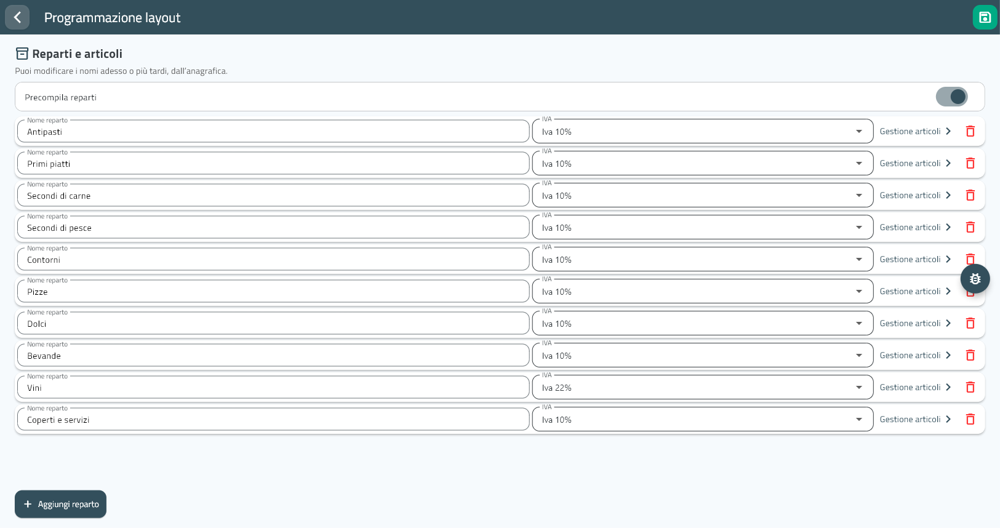
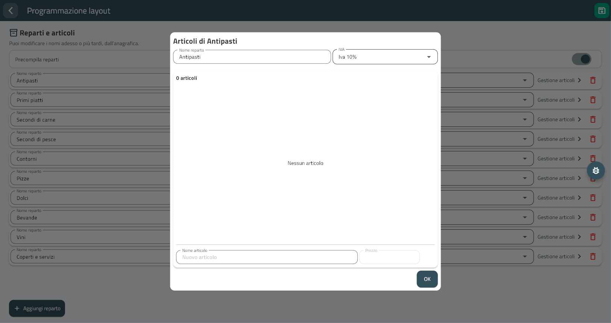
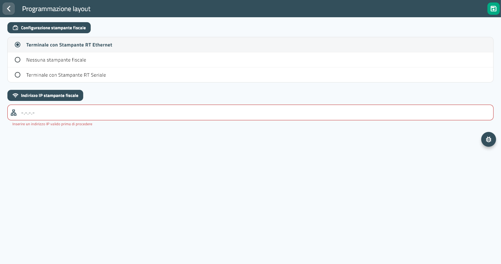
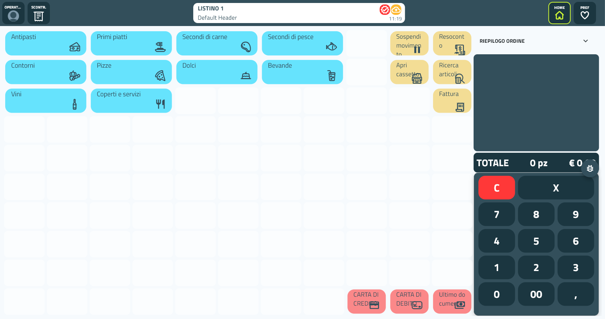

# Configurazione guidata: tipo di attività e reparti proposti

La configurazione guidata parte alla prima accensione di un'installazione nuova. Dalla 2.0.20 chiede che tipo di attività è il locale e propone reparti e tasti adatti, da rivedere prima di salvare. Nella 1.0.33 la configurazione guidata creava solo tasti reparto generici.

[Scarica la guida in PDF](assets/resources/guida-configurazione-guidata.pdf)

## Come si usa

### 1. Modalità e tipo di installazione

Scegliere **Cassa principale** e confermare, poi **Nuovo layout** («Importa backup» serve a ripartire da un backup esistente).

*Seleziona modalità: Cassa principale, Palmare, Terminale di sala, Cassa secondaria*

### 2. Dispositivo e schermo

Scegliere il dispositivo (Dispositivo generico per un PC, oppure Fusion, Edge, OmniTouch, Silk), poi la dimensione dello schermo e uno dei layout proposti. Si conferma con il pulsante verde in alto a destra.

*Scelta del dispositivo*

*Dimensione dello schermo e layout proposti*

### 3. Che tipo di attività? (novità)

Il passo nuovo decide reparti e tasti proposti. Si possono cambiare dopo.

*Il nuovo passo «Che tipo di attività?»*

| Tipo di attività | Cosa prepara |
| --- | --- |
| Generico (con reparti) | Tasti reparto generici, come nella 1.0.33 |
| Generico (tasti vuoti) | Tasti vuoti da configurare |
| Bar | 10 reparti da bar e tasti per il banco |
| Ristorante | 10 reparti da ristorante e tasti per sala e segue |
| Negozio | 10 reparti merceologici e tasti per la vendita al dettaglio |

### 4. Reparti e articoli

Con Bar, Ristorante o Negozio la cassa propone 10 reparti con la loro IVA (interruttore **Precompila reparti**). Nomi e IVA si cambiano qui o più tardi dall'anagrafica; il cestino toglie un reparto, **Aggiungi reparto** ne aggiunge uno.

*I 10 reparti proposti per il Ristorante, con IVA*

Gli articoli non vengono creati: per aggiungerli toccare **Gestione articoli** sul reparto, scrivere il nome nella riga «Nuovo articolo» e poi il prezzo.

*Gestione articoli di un reparto: riga «Nuovo articolo»*

Reparti proposti e IVA:

| Bar | Ristorante | Negozio |
| --- | --- | --- |
| Caffetteria – 10% | Antipasti – 10% | Ortofrutta – 4% |
| Bibite – 10% | Primi piatti – 10% | Macelleria – 10% |
| Birre – 22% | Secondi di carne – 10% | Salumi e formaggi – 10% |
| Aperitivi – 22% | Secondi di pesce – 10% | Pane e pasticceria – 4% |
| Vini – 22% | Contorni – 10% | Pasta e riso – 4% |
| Liquori e amari – 22% | Pizze – 10% | Conserve e scatolame – 10% |
| Colazione – 10% | Dolci – 10% | Latticini e uova – 10% |
| Panini e tramezzini – 10% | Bevande – 10% | Bevande – 22% |
| Snack – 10% | Vini – 22% | Surgelati – 10% |
| Gelati e dolci – 10% | Coperti e servizi – 10% | Casa e igiene – 22% |

!!! warning "Attenzione"
    Le aliquote sono una proposta: vanno controllate con l'esercente prima di salvare.

### 5. Stampante fiscale

Scegliere RT Ethernet (con l'indirizzo IP), RT seriale oppure Nessuna stampante fiscale, poi confermare il layout. La scelta del layout non è del tutto reversibile.

*Scelta della stampante fiscale e indirizzo IP della RT*

### 6. La cassa pronta

La tastiera nasce con i reparti scelti, ognuno con la sua icona, e con i tasti funzione del tipo di attività.

*Tastiera generata per il Ristorante (senza licenza Horeca)*

| Tipo di attività | Tasti funzione proposti |
| --- | --- |
| Bar | Ricerca articoli, Lettura barcode, Ricerca clienti, Apri cassetto, Sconto % sul totale, Sospendi movimento, Annulla documento RT, Fattura |
| Ristorante | Vista sala e tavoli, Resoconto (preconto), Inserisci segue, Avanza segue, Dividi conto, Conto alla romana, Sospendi movimento, Ricerca articoli, Apri cassetto, Fattura |
| Negozio | Ricerca articoli, Lettura barcode, Ricerca clienti, Fattura, Ricerca partita IVA, Sconto % articolo, Sconto % sul totale, Annulla documento RT, Apri cassetto |
| Generico | Ricerca clienti, Ricerca articoli, Fattura, Apri cassetto |

In tutti i casi ci sono anche i tasti dei pagamenti con carta. Vista sala e tavoli, i tasti del segue, Dividi conto e Conto alla romana compaiono solo con il modulo Horeca nella licenza; se lo spazio non basta, gli ultimi tasti dell'elenco restano fuori.

## Da sapere

- Rifare la configurazione guidata su una cassa già in uso non rinomina più i reparti esistenti né ne cambia l'IVA.
- Se la configurazione guidata si interrompe, al riavvio riparte dal punto giusto.

??? info "Riferimenti"
    Vale per Inventa One 2.0.20 e successive. Guida verificata il 16/11/2026.

    Card di riferimento: [IFEV-3196](https://customgroup.atlassian.net/browse/IFEV-3196), [IFEV-4082](https://customgroup.atlassian.net/browse/IFEV-4082).
