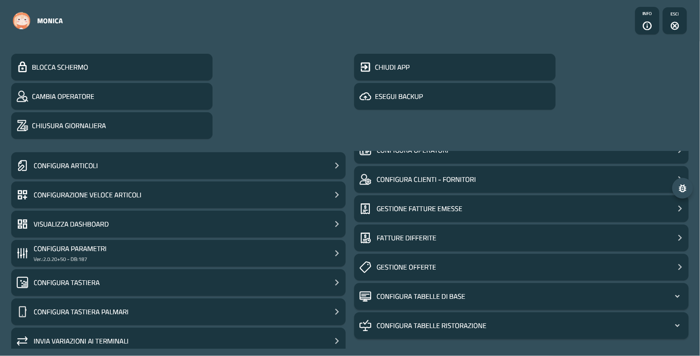
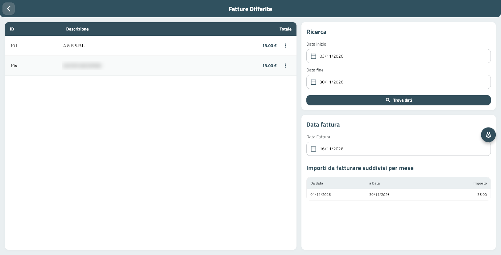
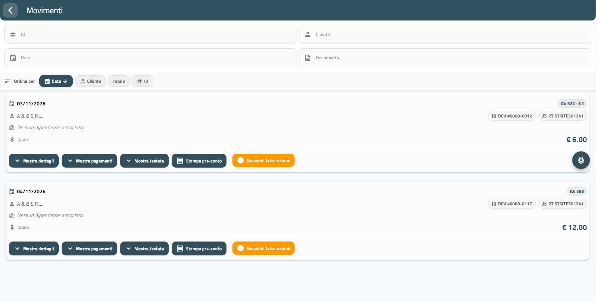
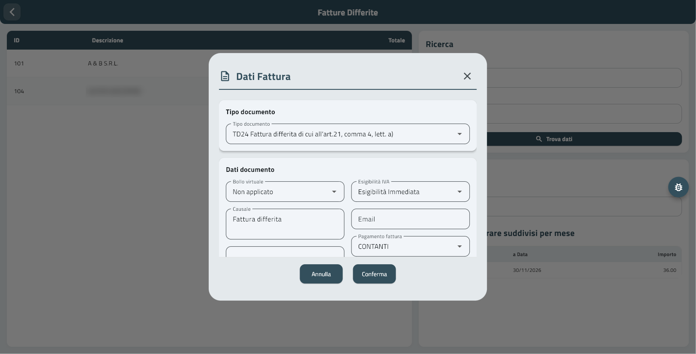
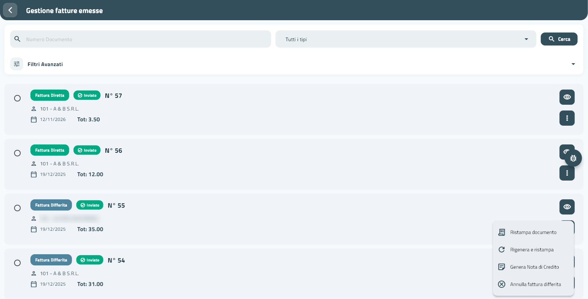

# Fattura differita e «Rigenera e ristampa»

La fattura differita (TD24) raccoglie in una sola fattura gli scontrini di un cliente pagati con il pagamento postpagato (parametro **Pagamento clienti postpagato**, di solito «CREDITO FATTURE»).

!!! note "Nota"
    La voce **Fatture differite** c'è solo nei locali senza Inventa Backoffice. Con il backoffice la fattura di fine mese si fa dal backoffice, così gli scontrini non vengono fatturati due volte.

[Scarica la guida in PDF](assets/resources/guida-fattura-differita.pdf)

## Come si usa

### Emettere la fattura

1. Menu dell'operatore → **Fatture differite**.

    

    *La voce Fatture differite nel menu dell'operatore*

2. Impostare **Data inizio** e **Data fine** e toccare **Trova dati**: compare un elenco per cliente con il totale da fatturare. A destra ci sono la data della fattura e gli importi divisi per mese.

    

    *Clienti con scontrini da fatturare nel periodo*

3. Dal menu ⋮ del cliente, **Visualizza movimenti** mostra gli scontrini che entrano in fattura. Con **Sospendi fatturazione** uno scontrino resta fuori da questa fattura.

    

    *Scontrini del cliente, con Sospendi fatturazione*

4. Dal menu ⋮ del cliente, **Elabora fattura**: la cassa dice quanti scontrini entrano e il totale. Dopo la conferma si completano i dati della fattura (tipo TD24, bollo, esigibilità IVA, causale, email, pagamento) e si conferma.

    

    *Dati della fattura differita prima dell'emissione*

Rispetto alla 1.0.33, se l'emissione si interrompe non nasce più una seconda fattura con gli stessi scontrini, e la fattura differita non include più le vendite annullate.

### Rigenera e ristampa

1. Menu dell'operatore → **Gestione fatture emesse** → menu ⋮ della fattura.
2. **Rigenera e ristampa** rifà il file della fattura e la ristampa con lo stesso sezionale e lo stesso numero. Nella 1.0.33 poteva perdere il sezionale e cambiare numero.

*Il menu di una fattura differita emessa*

- **Ristampa documento** ristampa solo la copia di cortesia.
- **Annulla fattura differita** vale solo per le TD24 e si può fare solo dopo aver generato la nota di credito dallo stesso menu.

## Altre novità sulle fatture

- Accettato il codice fiscale numerico delle società.
- Verso MyCustom i certificati sono dentro l'app: un problema di certificato non appare più come «Configurazione errata» ma con un messaggio chiaro.
- Corretti: numero della fattura elettronica oltre 20 caratteri con sezionali lunghi; «Ritenta invio» che mandava anche le fatture annullate.
- Nuova pagina per consultare e reinviare gli scontrini dematerializzati.

??? info "Riferimenti"
    Vale per Inventa One 2.0.21 (schermate della 2.0.20). Guida verificata il 16/11/2026.

    Card di riferimento: [IFEV-2767](https://customgroup.atlassian.net/browse/IFEV-2767), [IFEV-2895](https://customgroup.atlassian.net/browse/IFEV-2895), [IFEV-3972](https://customgroup.atlassian.net/browse/IFEV-3972).
