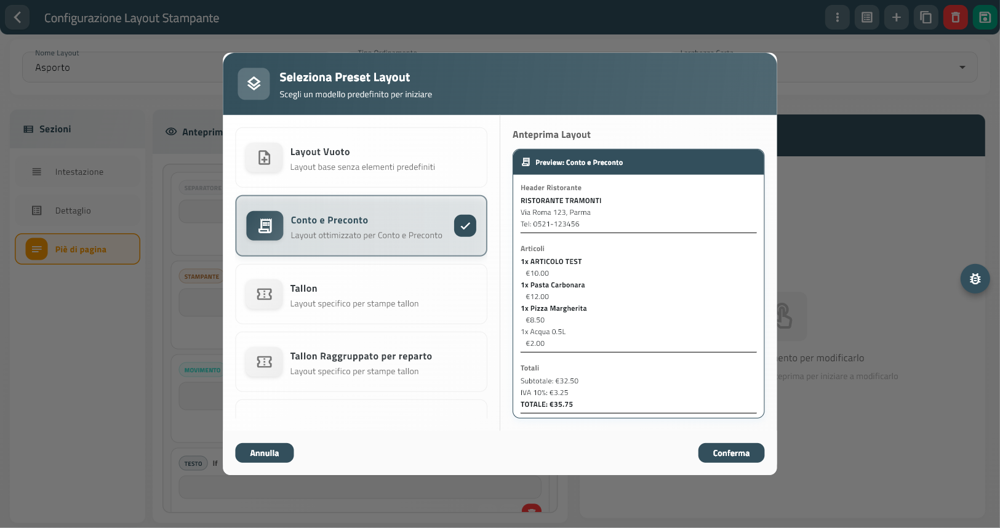
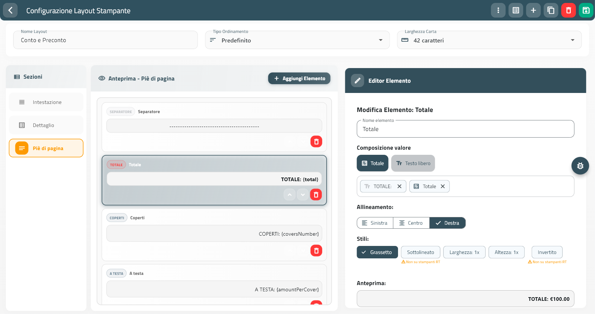
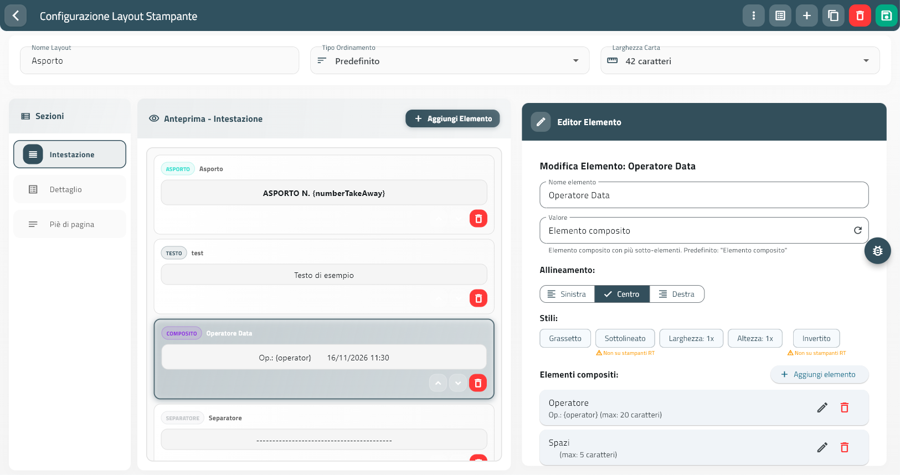

# Layout di stampa: preset e composizione a blocchi

Si apre da menu dell'operatore → **Configura tabelle di base** → **Layout stampe**.

[Scarica la guida in PDF](assets/resources/guida-layout-stampa.pdf)

## Come si usa

### Nuovo layout da un preset

Con il **+** in alto a destra si sceglie un modello di partenza, con l'anteprima a destra: Layout vuoto, Conto e Preconto, Tallon, Tallon raggruppato per reparto. I preset Tallon ci sono anche senza modulo Horeca.

*Scelta del preset con anteprima*

### Composizione a blocchi del valore (novità)

Nella 1.0.33 il valore di un elemento si scriveva come testo. Ora elementi come Totale, Coperti, Importo a testa, Pagamenti, IVA, Sottoconti e Separatore di gruppo si compongono a blocchi:

1. Toccare l'elemento nell'anteprima: a destra si apre l'**Editor Elemento**.
2. In **Composizione valore** aggiungere un campo (per esempio Totale) o un **Testo libero**; i blocchi si riordinano e si tolgono con la X.
3. Allineamento e stili si scelgono sotto; in fondo l'**Anteprima** mostra il risultato con un valore di esempio.
4. Salvare con il pulsante verde in alto a destra.

*Totale composto da «TOTALE:» (testo libero) e dal campo Totale*

Gli elementi compositi (per esempio Operatore e Data) si compongono con **Aggiungi elemento** nella stessa scheda.

*Elemento composito Operatore Data*

## Da sapere

- **Taglio**: oltre ai tasti rapidi si sceglie il tipo di taglio e quante righe far avanzare prima.
- **Nomi lunghi**: nelle comande i nomi lunghi vanno a capo anche in doppia larghezza, invece di perdere pezzi.
- **Stampa di prova**: non cambia più il layout assegnato alla stampante.
- Gli stili segnati «Non su stampanti RT» (Sottolineato, Invertito) non escono sulla RT.
- Il test della stampante comande è nella scheda della stampante: vedi [Stampanti comande](stampanti-comande.md) e [Verifiche per l'installatore](verifiche-installatore.md).

??? info "Riferimenti"
    Vale per Inventa One 2.0.20 e successive. Guida verificata il 16/11/2026.

    Card di riferimento: [IFEV-1568](https://customgroup.atlassian.net/browse/IFEV-1568), [IFEV-1669](https://customgroup.atlassian.net/browse/IFEV-1669), [IFEV-3431](https://customgroup.atlassian.net/browse/IFEV-3431), [IFEV-3599](https://customgroup.atlassian.net/browse/IFEV-3599).

    Per l'ordine delle righe la guida originale rimanda alla pagina «Layout di stampa: come funziona Tipo ordinamento».
