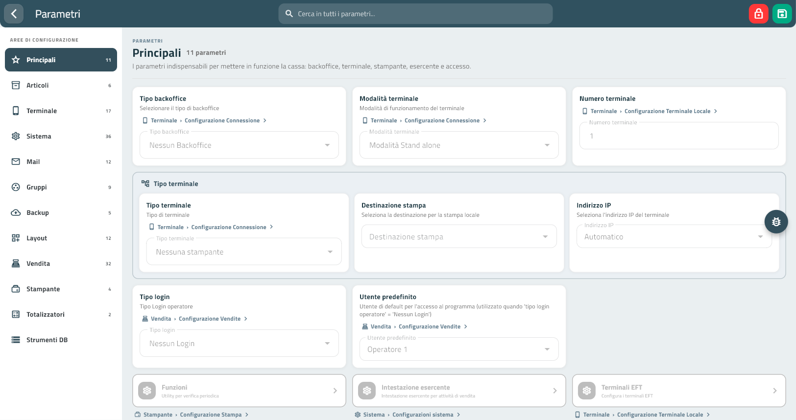
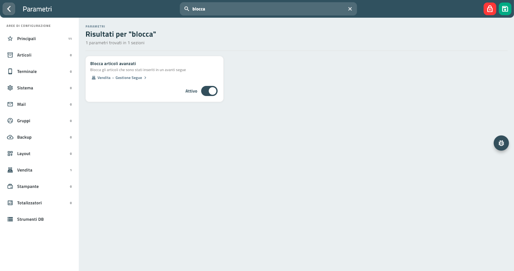
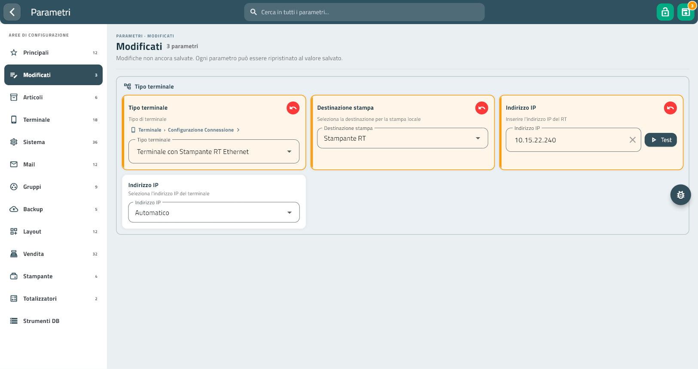

# Parametri: la nuova pagina con aree e ricerca

Si entra come prima: menu dell'operatore → **Configura parametri**, con la password del tecnico. La pagina è stata ridisegnata: i parametri sono gli stessi, cambia il modo di trovarli.

[Scarica la guida in PDF](assets/resources/guida-parametri.pdf)

*La pagina Parametri: aree a sinistra, area Principali aperta*

## Come si usa

### Aree di configurazione

A sinistra ci sono le aree, con il numero di parametri: Principali, Articoli, Terminale, Sistema, Mail, Gruppi, Backup, Layout, Vendita, Stampante, Totalizzatori, Strumenti DB. **Principali** raccoglie gli 11 parametri indispensabili per mettere in funzione la cassa: backoffice, modalità e numero del terminale, tipo di terminale e stampante, accesso degli operatori. Ogni scheda mostra sotto il titolo l'area e il gruppo in cui si trova.

### Ricerca

In alto c'è **Cerca in tutti i parametri**: si scrive una parola e la pagina mostra solo i parametri che la contengono, con il numero di risultati per area. La X a destra toglie la ricerca.

*Ricerca di «blocca»: trova «Blocca articoli avanzati» in Vendita › Gestione Segue*

### Modificare e salvare

1. La pagina si apre bloccata: toccare il **lucchetto rosso** in alto a destra per poter modificare.
2. Ogni parametro cambiato si colora di arancione e ha un pulsante rosso per tornare al valore salvato.
3. A sinistra compare l'area **Modificati** con le sole modifiche non ancora salvate; il loro numero è anche sul pulsante Salva.
4. Toccare **Salva** (in alto a destra).

*L'area Modificati con tre parametri cambiati e il pulsante Test accanto all'indirizzo IP della RT*

## Da sapere

- Alcuni parametri ne fanno comparire altri: scegliendo la RT Ethernet, per esempio, compaiono l'indirizzo IP della RT e il pulsante **Test** (vedi [Verifiche per l'installatore](verifiche-installatore.md)).
- Sui terminali client, di sala e palmari i parametri del backoffice non compaiono.
- Le 19 vecchie pagine di configurazione sostituite dalle anagrafiche nuove non ci sono più.
- La lingua dell'applicazione ora si sceglie dai Parametri.

??? info "Riferimenti"
    Vale per Inventa One 2.0.20 e successive. Guida verificata il 16/11/2026.

    Card di riferimento: [IFEV-3087](https://customgroup.atlassian.net/browse/IFEV-3087), [IFEV-4032](https://customgroup.atlassian.net/browse/IFEV-4032), [IFEV-3685](https://customgroup.atlassian.net/browse/IFEV-3685).
