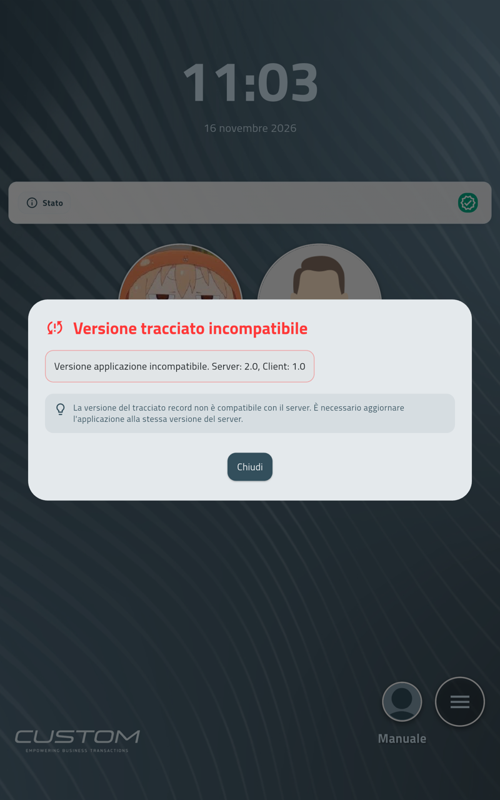
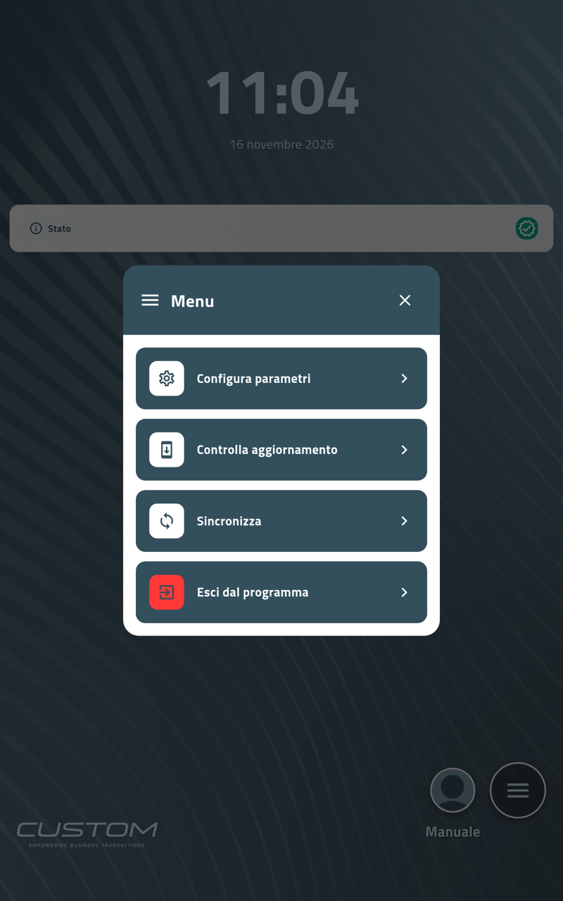
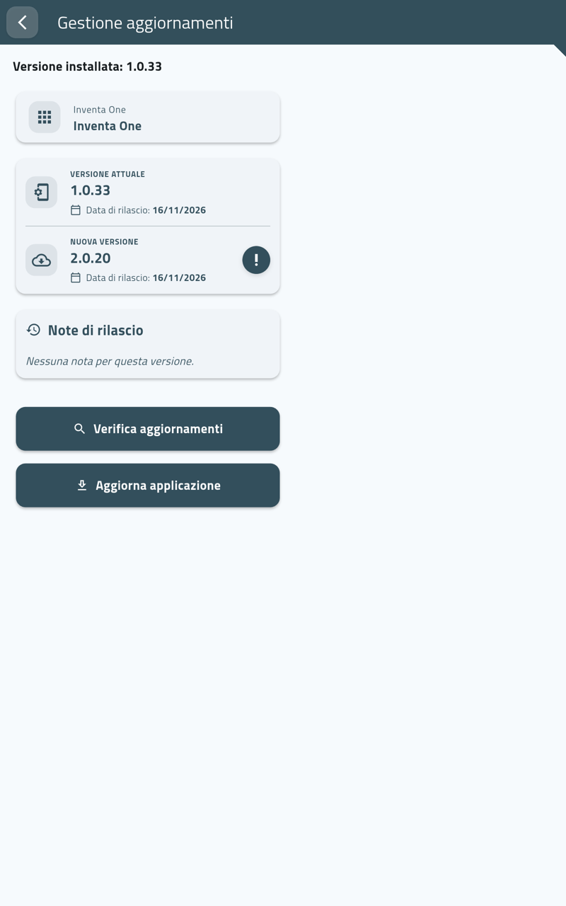
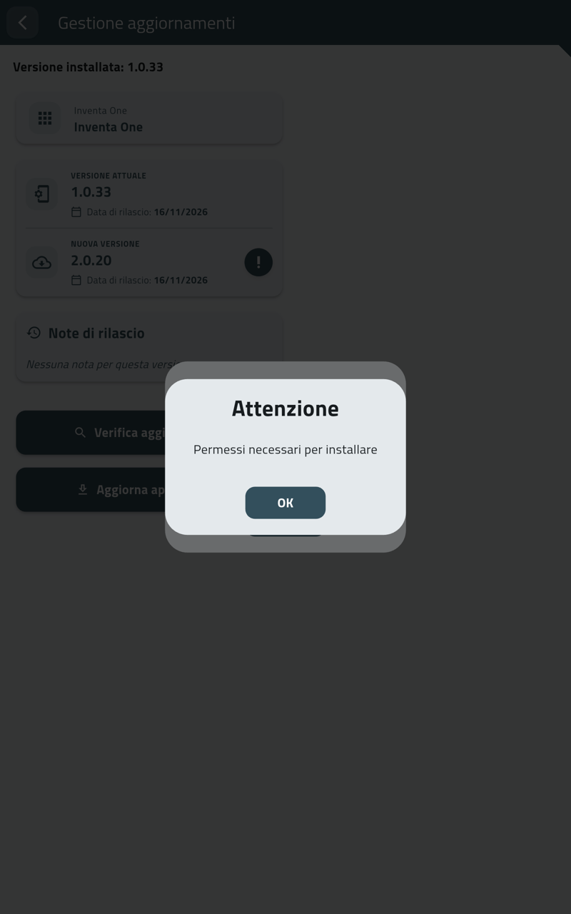
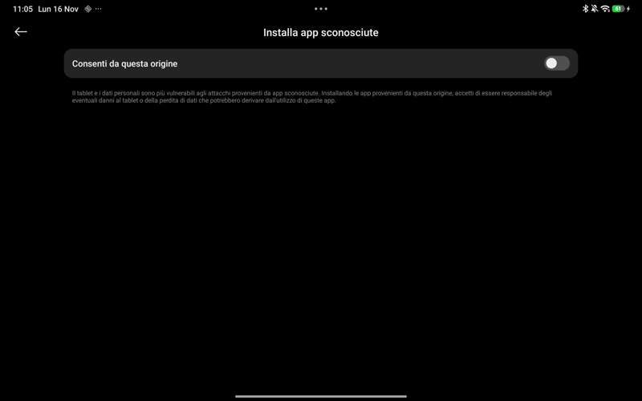
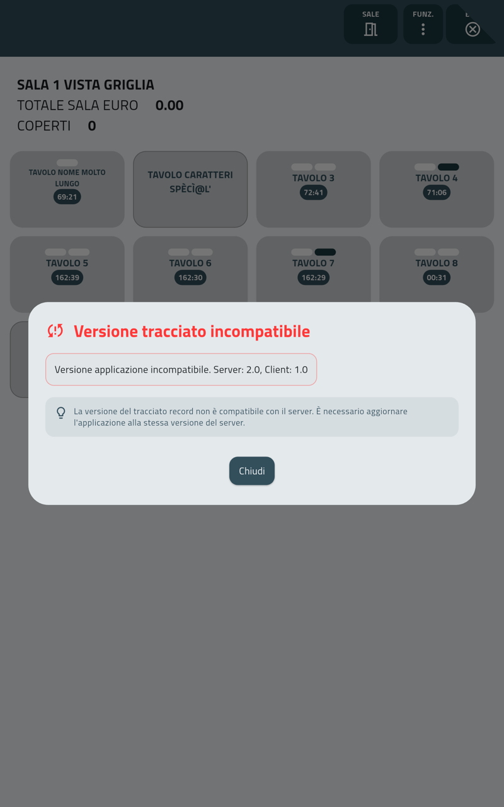
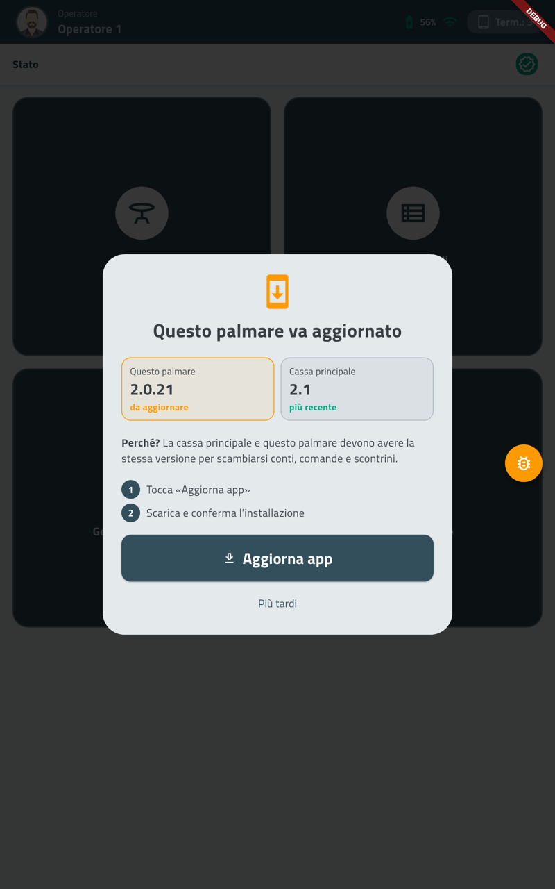
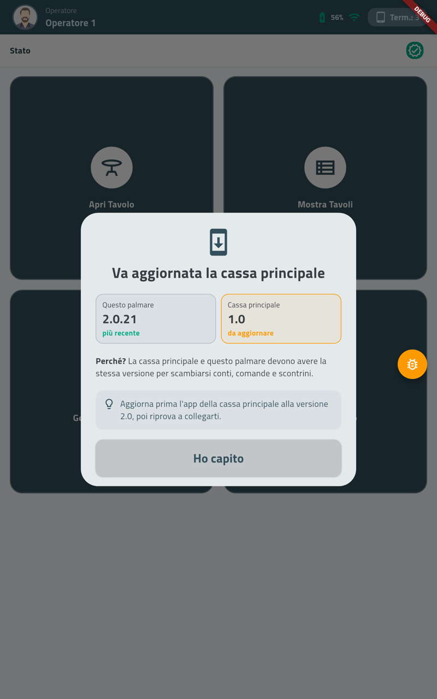

# Prima di aggiornare: cassa, palmari e canale della licenza

Cassa principale e palmari vanno aggiornati insieme. Un palmare rimasto alla 1.0.33 con la cassa alla 2.0.21 mostra la finestra rossa «Versione tracciato incompatibile» e non lavora.

Alla prima apertura la cassa aggiorna da sola il database e ne tiene una copia di sicurezza. Cassa principale, casse secondarie, terminali di sala e palmari devono avere la stessa linea: con versioni di linea diversa non si scambiano conti e comande.

## Procedura di aggiornamento

1. Aggiornare a locale chiuso, con tutti i tavoli chiusi.
2. Aggiornare prima la cassa principale, poi subito tutti i palmari e le casse secondarie.
3. Sui palmari: **Menu** › **Controlla aggiornamento** › **Aggiorna applicazione**. La prima volta Android chiede il permesso «Installa app sconosciute», che va concesso.
4. Alla fine controllare che tutti i terminali abbiano la versione 2.0.21 e fare una comanda di prova da ogni palmare.

## Aggiornare un palmare passo per passo

|  |  |  |
| :---: | :---: | :---: |
| Palmare alla 1.0.33 con la cassa già alla 2.0: avviso «Versione tracciato incompatibile» | Menu del palmare › Controlla aggiornamento | Gestione aggiornamenti: versione installata, nuova versione, Aggiorna applicazione |

|  |  |  |
| :---: | :---: | :---: |
| Prima installazione: Android chiede i permessi | Abilitare «Consenti da questa origine» in Installa app sconosciute | L'avviso compare anche in sala finché il palmare non è aggiornato |

## Da dove arriva l'aggiornamento

Ogni terminale scarica l'aggiornamento dal canale della propria licenza (produzione o test), non dalla cassa principale. Un palmare con licenza di produzione, da «Controlla aggiornamento», trova solo la versione pubblicata in quel canale.

!!! warning "Attenzione"
    Prima di aggiornare un locale va verificato con lo sviluppo che la 2.0.21 sia disponibile nel canale della licenza di quel locale. Altrimenti i palmari non trovano l'aggiornamento e restano incompatibili con la cassa.

## L'avviso di aggiornamento dei terminali

La 2.0.21 introduce un nuovo avviso che dice quale terminale va aggiornato, mette a confronto le due versioni, spiega il motivo in una riga e ha il pulsante «Aggiorna app» che apre la pagina degli aggiornamenti. Compare quando un palmare, una cassa secondaria o un terminale di sala ha una versione diversa dalla cassa principale.

È una novità che vale per gli aggiornamenti futuri: la mostra solo un terminale che ha già la 2.0.21. Chi aggiorna dalla 1.0.33 vede ancora l'avviso vecchio «Versione tracciato incompatibile» sui terminali rimasti indietro: si risolve aggiornandoli.

|  |  |
| :---: | :---: |
| Avviso nuovo: «Questo palmare va aggiornato», con confronto delle versioni e «Aggiorna app» | Avviso nuovo quando è la cassa principale a essere indietro |

## Tornare alla 1.0

Si può reinstallare la 1.0.33. Aprendola su un database già passato alla 2.0 compare «Database di una versione più recente»: si chiude con OK e il programma si apre lo stesso.

## Dopo l'aggiornamento

A fine lavoro conviene seguire la [checklist delle verifiche consigliate](checklist-verifiche.md).

??? info "Riferimenti"
    Card di riferimento: IFEV-3531, IFEV-4010 (aggiornamento dalla 1.0.33), IFEV-4307 (avviso di aggiornamento dei terminali).

    Fonti: Guida al changelog per i tecnici installatori (cap. 2), «Inventa One 2.0.21 – cosa cambia rispetto alla 1.0.33», schermate «Terminale con una versione diversa dalla cassa principale».
