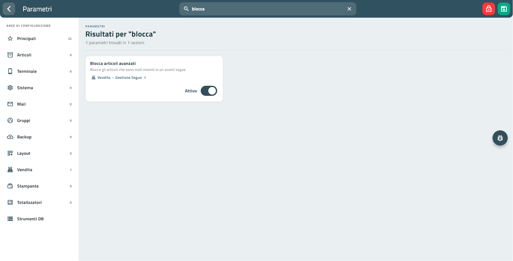
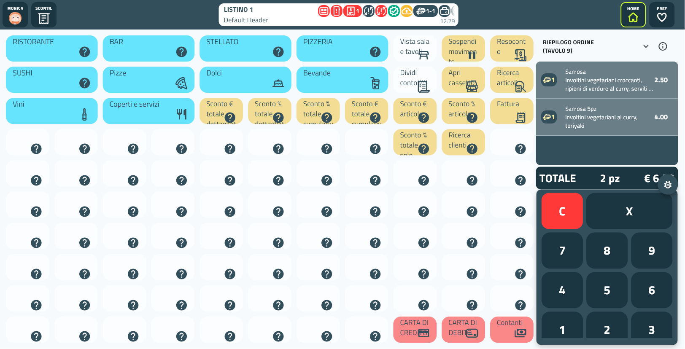
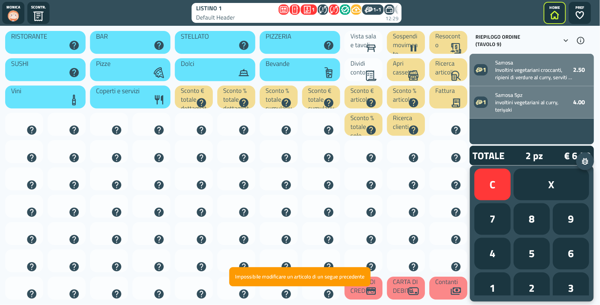
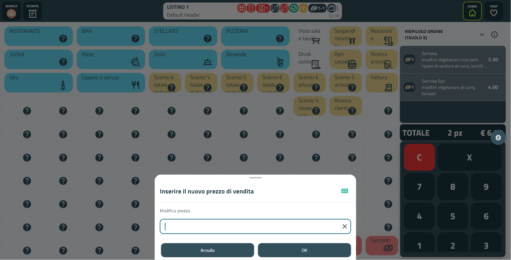
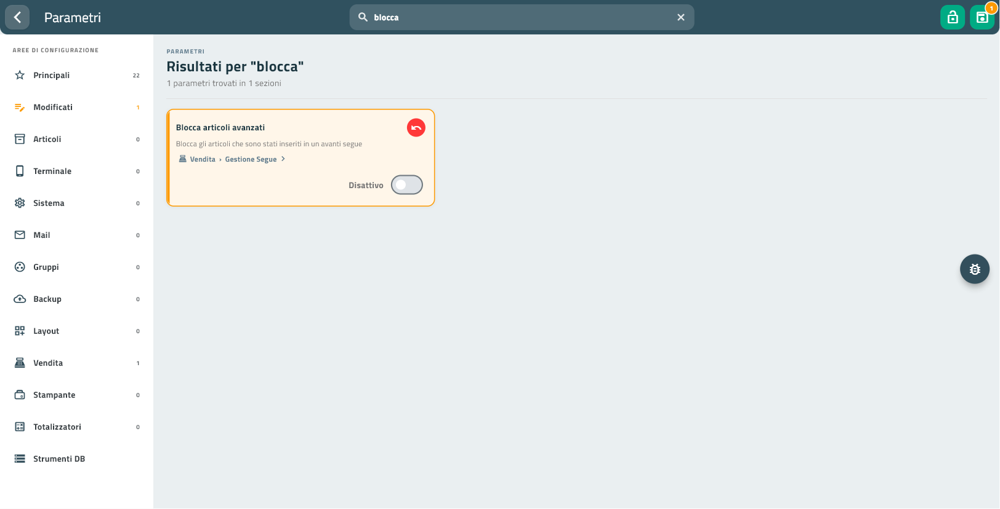
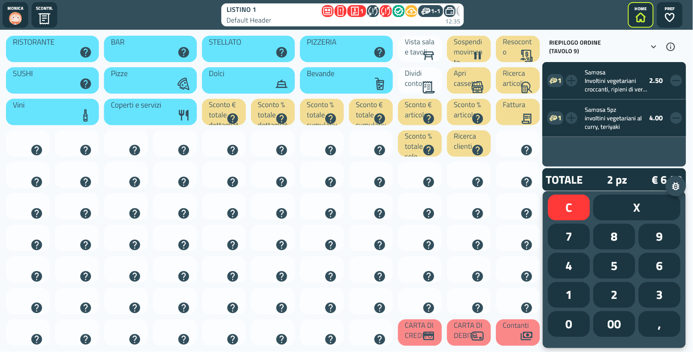

# Segue già in cucina: il parametro «Blocca articoli avanzati»

Quando un'uscita (segue) è già partita in cucina, il parametro **Blocca articoli avanzati** decide cosa si può ancora cambiare sui suoi piatti. Il blocco vale al tavolo, con la gestione dei segue attiva.

Risponde a due richieste dei locali: poter cambiare il prezzo di un piatto già avanzato, e poter stornare un piatto già stampato in un segue.

[Scarica la guida in PDF](assets/resources/guida-segue-blocca-articoli-avanzati.pdf)

## Come si usa

### Dove si imposta

1. Parametri → cercare «blocca» (oppure area Vendita › Gestione Segue).
2. Sbloccare la pagina con il lucchetto, scegliere **Attivo** (predefinito) o **Disattivo** e salvare con il pulsante verde.

*Il parametro trovato con la ricerca dei Parametri*

### Con il parametro attivo (predefinito)

- I piatti di un segue già partito restano in griglia in grigio, senza i pulsanti + e −.

    

    *Tavolo riaperto dopo il «via» del segue 1: righe bloccate*

- Elimina riga (storno), modifica quantità, split, varianti, note e «Sposta in altro segue» sono rifiutati con l'avviso «Impossibile modificare un articolo di un segue precedente».

    

    *Storno rifiutato su un piatto già partito*

- Prezzo, IVA, sconto e omaggio si possono cambiare: toccano solo l'importo, non la cucina.

    

    *La modifica del prezzo resta permessa*

- Un piatto aggiunto per un segue già partito finisce nel segue successivo, così esce in cucina al prossimo «via».
- Piatti già inviati ma di un segue non ancora partito: il + non aumenta la riga (il pezzo in più va su una riga nuova) e il − scende solo fino alla quantità già inviata. L'avviso è «Articolo già inviato in cucina: modifica non consentita».

### Con il parametro disattivo

*Parametro portato a Disattivo, da salvare*

- Le righe tornano modificabili, con + e −.
- Lo storno è permesso: alla sospensione del tavolo esce in cucina l'annullo, con la quantità negativa sotto il segue del piatto.

*Con il blocco spento le righe hanno di nuovo + e −*

### Eccezione per alcuni operatori

Il permesso **Modifica righe inviate in cucina** del gruppo di operatori toglie il blocco a chi lo ha. È spento di default: va acceso solo per chi deve poter correggere i piatti già partiti, per esempio il responsabile di sala.

## Altre novità su tavoli e comande

- **Pressione lunga su «Sospendi»**: sospende il conto senza stampare le comande, dopo una domanda di conferma.
- **«Coperti obbligatori»** su una sala senza articoli di tipo coperto: la cassa propone di crearne uno.
- **Corretti**: tavolo che restava «in corso» dopo Dividi conto o conto alla romana; articoli spariti spostandoli fra tavoli; piatto tolto da un segue già in cucina senza annullo; numero d'asporto ripetuto.

??? info "Riferimenti"
    Vale per Inventa One 2.0.21 (schermate della 2.0.20). Guida verificata il 16/11/2026.

    Card di riferimento: IFEV-4045, IFEV-4049. FST collegate: FST-3157, FST-3158.
