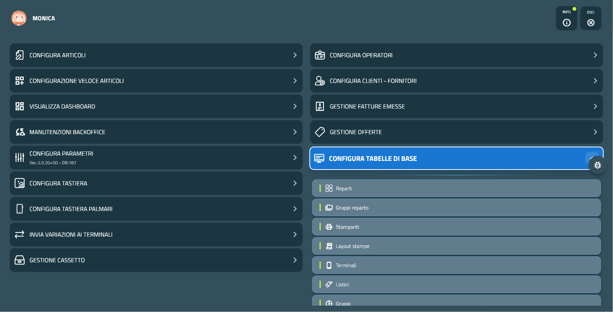
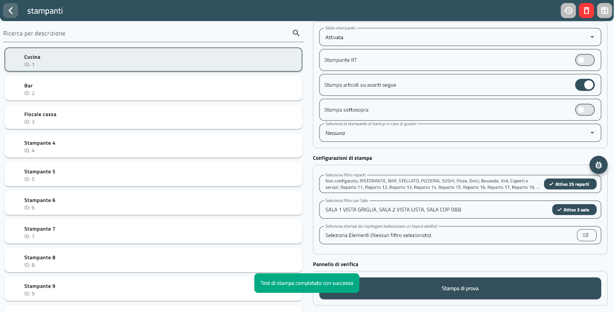
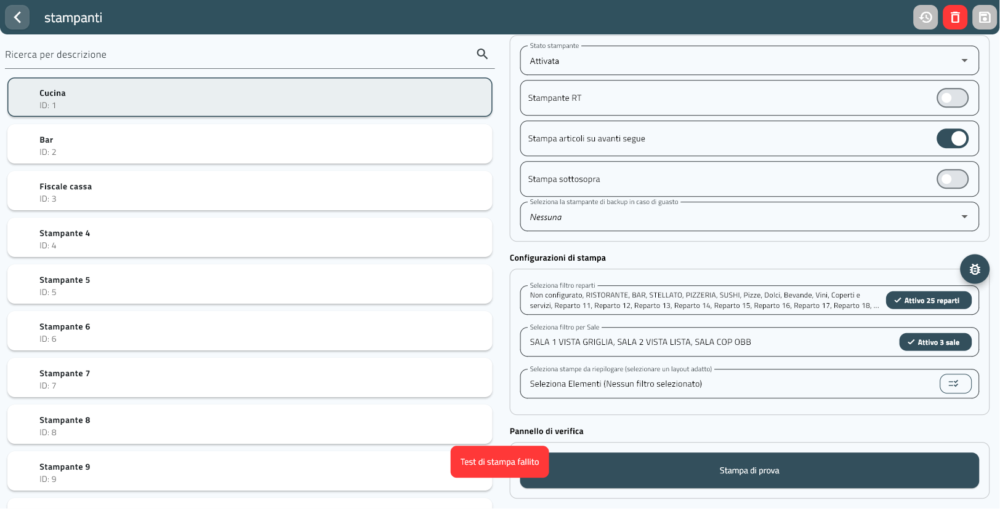
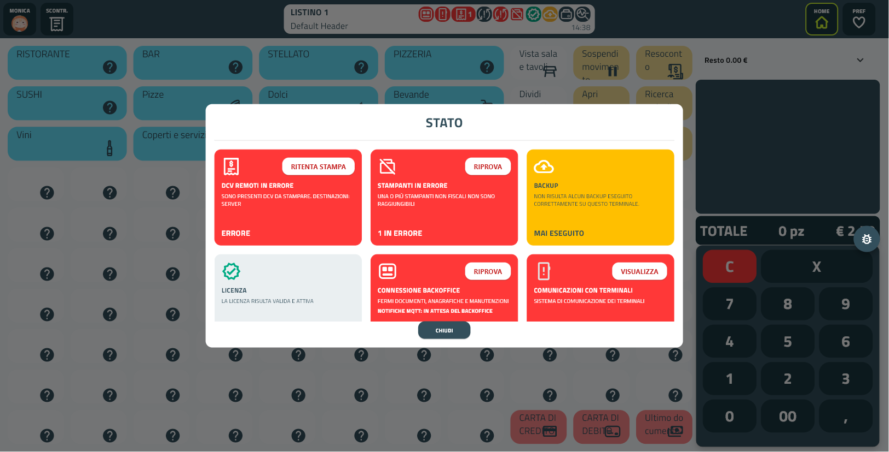
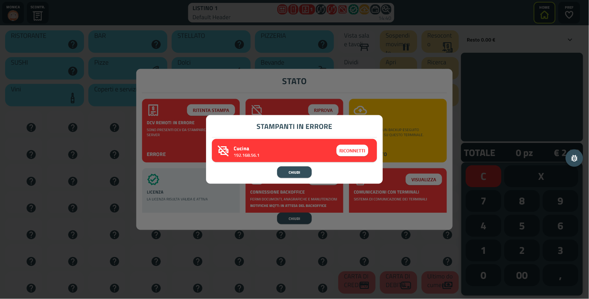

# Stampanti comande: stampa di prova e comande non stampate

La stampante comande si prova dalla sua scheda, senza fare un ordine. Una comanda che non esce non va persa: resta in coda e la cassa lo segnala.

[Scarica la guida in PDF](assets/resources/guida-stampanti-comande.pdf)

## Come si usa

### Stampa di prova

1. Menu dell'operatore → **Configura tabelle di base** → **Stampanti**.

    

    *Stampanti in Configura tabelle di base*

2. Scegliere la stampante, scorrere fino al **Pannello di verifica** e toccare **Stampa di prova**. Esce un foglio «STAMPA DI PROVA» con il nome e l'indirizzo della stampante.

    

    *Stampa di prova riuscita*

- La prova usa l'indirizzo IP scritto nella scheda, anche se non è ancora salvato: si può controllare un indirizzo prima di salvarlo.
- Vale solo per le stampanti non fiscali.
- Se la stampante non risponde compare «Test di stampa fallito»: controllare accensione, carta, cavo di rete e indirizzo.

*Stampante spenta o indirizzo sbagliato: «Test di stampa fallito»*

### Se una comanda non esce

- Con la stampante spenta o non raggiungibile la comanda resta in coda: non si perde e non va rifatta.
- In alto si accende l'icona della stampante. Toccando le icone in alto, nella finestra **STATO** compare **Stampanti in errore** con il numero di stampanti che non rispondono.

    

    *La finestra STATO con «Stampanti in errore»*

- **Riprova** mostra le stampanti in errore con il loro indirizzo. Sistemata la stampante, **Riconnetti**.

    

    *Elenco delle stampanti in errore con Riconnetti*

- Quando la stampante torna raggiungibile, la cassa stampa da sola le comande rimaste in coda: controlla ogni minuto.

### Comande dei palmari: «Comande da stampare»

Sulla cassa principale con i palmari, le comande arrivate dai palmari e non ancora stampate compaiono nella finestra STATO come **Comande da stampare**, con quante sono in coda e quante sospese.

- **Ritenta la stampa** riprova subito. Nella 1.0.33 poteva dire «completato» anche con la stampante spenta; ora, finché la stampante non risponde, dice «Recupero non completato: alcune stampe sono ancora in coda. Riprovare.».
- **Elimina le sospese** toglie solo le comande sospese dopo troppi tentativi; quelle in attesa restano in coda. È meno drastico di «Svuota spool» nei Parametri, che cancella tutto.

!!! warning "Attenzione"
    La correzione per la comanda con stampante spenta o senza carta durante la stampa non è nel ramo del pilota: se un locale la segnala, non è ancora coperta dalla 2.0.21.

??? info "Riferimenti"
    Vale per Inventa One 2.0.21 (schermate della 2.0.20). Guida verificata il 16/11/2026.

    FST e card di riferimento: FST-3187, [IFEV-2933](https://customgroup.atlassian.net/browse/IFEV-2933), [IFEV-3426](https://customgroup.atlassian.net/browse/IFEV-3426).
