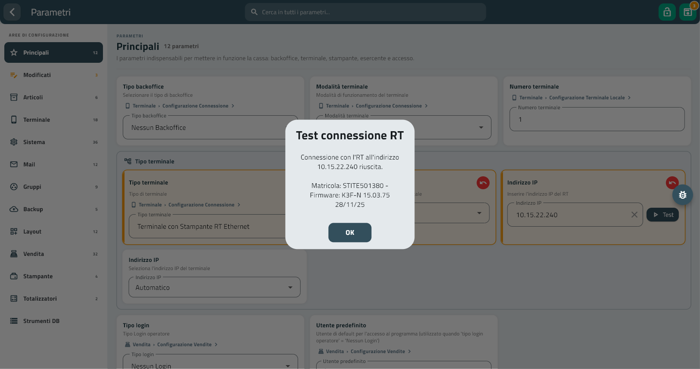
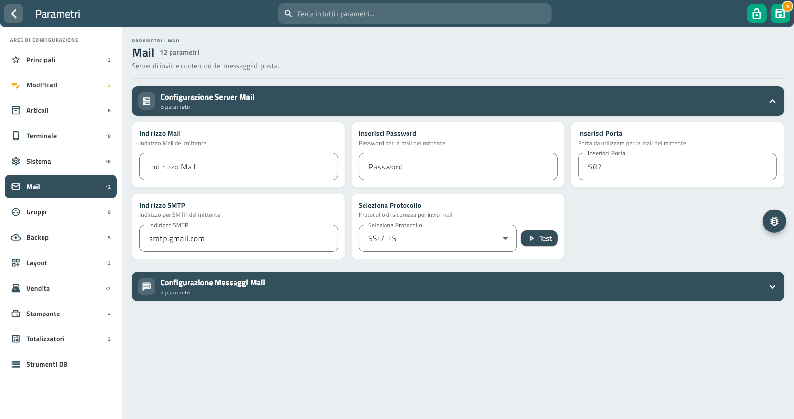
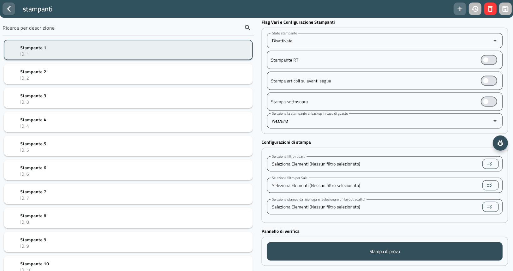

# Verifiche per l'installatore: i pulsanti di test

La 2.0 ha alcuni pulsanti per controllare la configurazione subito, senza fare una vendita. Conviene usarli a fine installazione o dopo l'aggiornamento.

[Scarica la guida in PDF](assets/resources/guida-verifiche-installatore.pdf)

## Come si usa

### RT: Test connessione

1. Parametri → Principali → Tipo terminale: **Terminale con Stampante RT Ethernet**.
2. Nella scheda **Indirizzo IP** scrivere l'indirizzo della RT e toccare **Test**.
3. Se la RT risponde compaiono matricola e firmware. Altrimenti il messaggio dice se l'indirizzo non è valido o se la RT non risponde.

*Test riuscito: la cassa legge matricola e firmware della RT*

!!! tip "Suggerimento"
    Il test non richiede di salvare prima: si può provare l'indirizzo e salvare solo se risponde.

### Mail: Test con invio di prova

1. Parametri → **Mail** → **Configurazione Server Mail**: indirizzo, password, porta, server SMTP e protocollo.
2. Toccare **Test** accanto al protocollo. La cassa verifica connessione e credenziali e manda una mail di prova all'indirizzo del mittente.
3. Se non riesce, il messaggio dice se è fallita la connessione o l'invio e suggerisce il protocollo giusto per la porta (587 con STARTTLS, 465 con SSL/TLS).

*Il pulsante Test della configurazione mail*

### Stampanti comande: Stampa di prova

1. Menu dell'operatore → **Configura tabelle di base** → **Stampanti** e scegliere la stampante.
2. In fondo alla scheda, nel **Pannello di verifica**, toccare **Stampa di prova**: esce un foglio «STAMPA DI PROVA». Il test vale per le stampanti non fiscali.

*Pannello di verifica nella scheda della stampante*

I dettagli sono nella guida [Stampanti comande](stampanti-comande.md).

### Altri controlli

- **Fatture elettroniche**: nei Parametri, accanto al tipo di invio fatture, il pulsante Test controlla dati del cedente e invio verso MyCustom.
- **Terminali di pagamento**: il test del POS funziona anche con la RT non in servizio; in quel caso fa una chiusura POS.
- **Barcode personalizzati**: «Prova lettura» mostra come la vendita leggerebbe un codice.
- **Layout di stampa**: la stampa di prova non cambia più il layout assegnato alla stampante.
- **Messaggi della RT**: per un errore non riconosciuto compare il codice restituito dalla stampante al posto di «errore sconosciuto», utile da riportare all'assistenza. L'avviso di chiusura Z obbligatoria non ha più il titolo «Errore».

??? info "Riferimenti"
    Vale per Inventa One 2.0.20 e successive. Guida verificata il 16/11/2026.

    FST e card di riferimento: FST-3186 → [IFEV-3310](https://customgroup.atlassian.net/browse/IFEV-3310), FST-3187 → [IFEV-2933](https://customgroup.atlassian.net/browse/IFEV-2933), [IFEV-2997](https://customgroup.atlassian.net/browse/IFEV-2997), [IFEV-4026](https://customgroup.atlassian.net/browse/IFEV-4026).
